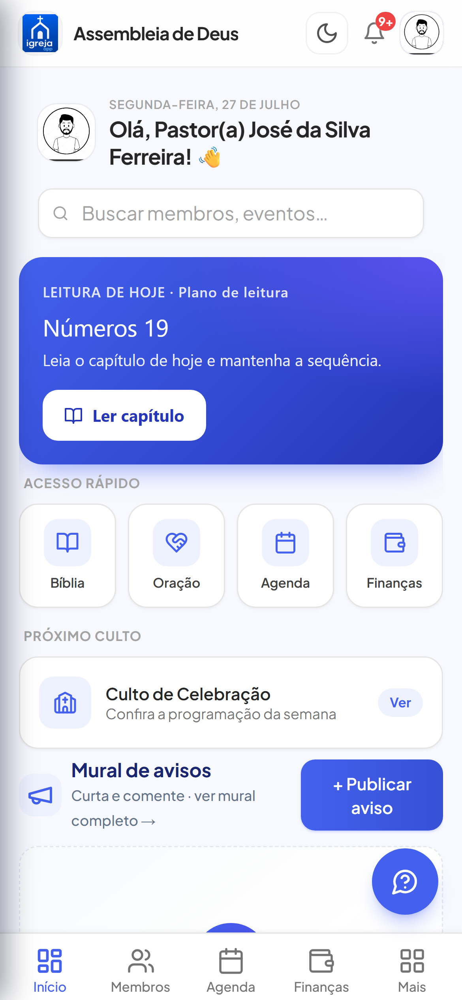
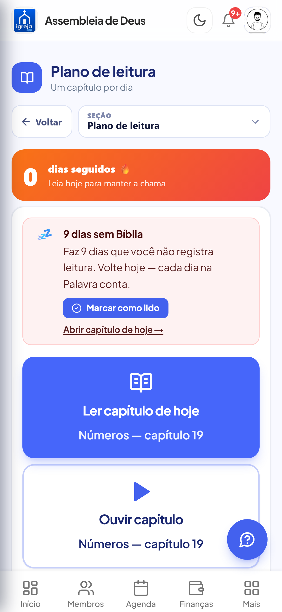
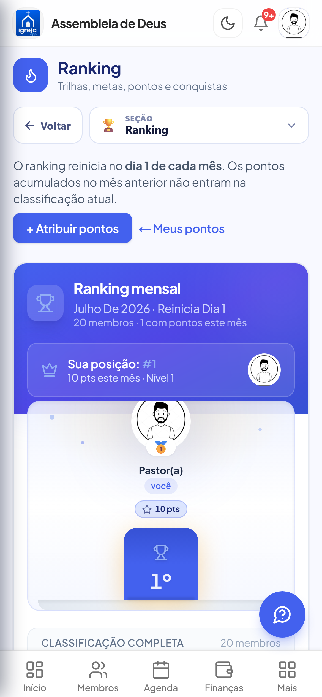
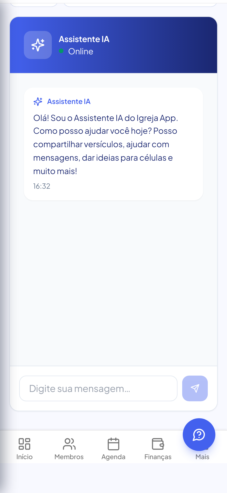
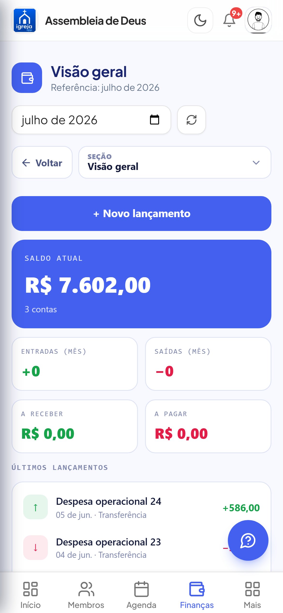
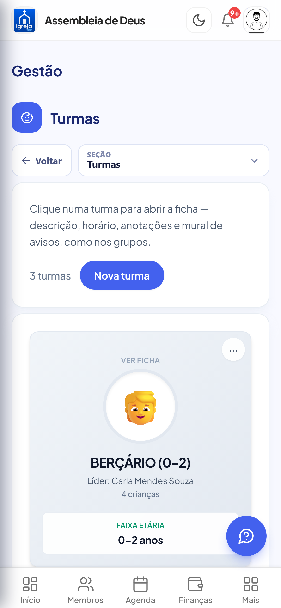

# ⛪ Igreja App: plataforma de gestão para igrejas

Plataforma SaaS **multi-tenant** para gestão de igrejas, com foco no **engajamento do membro pelo celular**: leitura da Bíblia, jornadas com pontos, oração e agenda. Para líderes e tesouraria, tem a gestão completa da igreja.

> 🔒 O código-fonte é privado. Este repositório mostra o sistema em funcionamento: **telas reais**, com dados de exemplo.

## 📱 Telas
<table>
<tr><td align="center"> Painel do membro</td><td align="center"> Plano de leitura da Bíblia</td><td align="center"> Ranking das jornadas</td></tr>
<tr><td align="center"> Assistente com IA</td><td align="center"> Financeiro</td><td align="center"> Kids</td></tr>
</table>

## Funcionalidades
- **Bíblia e plano de leitura:** capítulo do dia, sequência de dias seguidos e áudio do capítulo
- **Jornadas e gamificação:** trilhas, metas, pontos, conquistas e ranking mensal
- **Assistente com IA:** ajuda com versículos, mensagens e ideias para células, além de um quiz diário da Bíblia
- **Kids:** turmas por faixa etária e check-in por QR Code
- **Financeiro:** dízimos, ofertas, despesas, orçamento e patrimônio
- **Visitantes:** funil de acompanhamento, do primeiro contato até a decisão
- **Notificações:** no app e push no celular
- **Planos e assinatura:** Gratuito, Básico, Pro e Igreja Plena, com checkout pelo Stripe

## Em números
- Mais de **140 telas**
- **5 perfis de acesso** (membro, voluntário, líder, tesoureiro e administrador), além de um painel de super admin da plataforma
- Cada igreja tem seus dados isolados, com Row Level Security em todas as tabelas
- Auditoria de segurança concluída sem falhas críticas, com teste automatizado de isolamento entre igrejas
- API REST com chave de acesso para integrações

## Tecnologias

## Como foi feito
Eu defini os requisitos, as regras de negócio e os perfis de acesso. O desenvolvimento foi assistido por IA (Claude Code), testando cada funcionalidade antes de avançar.

## Contato
Demonstração completa sob solicitação: [LinkedIn](https://linkedin.com/in/brunaaganett) · [Portfólio](https://brunaaganettportifolio.lovable.app) · brunacassiane6@hotmail.com
